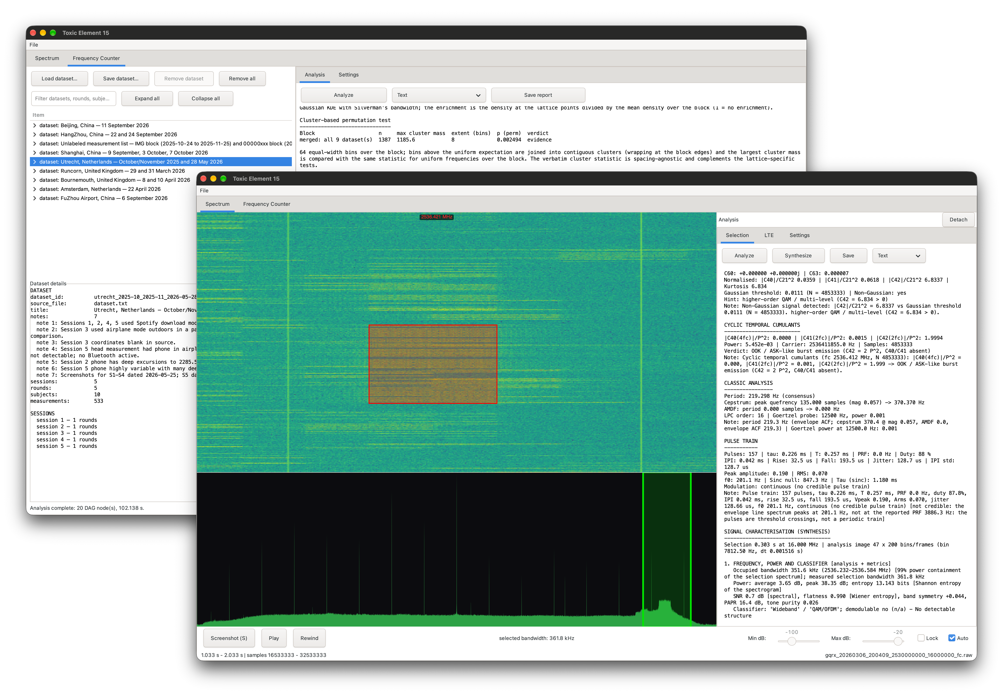
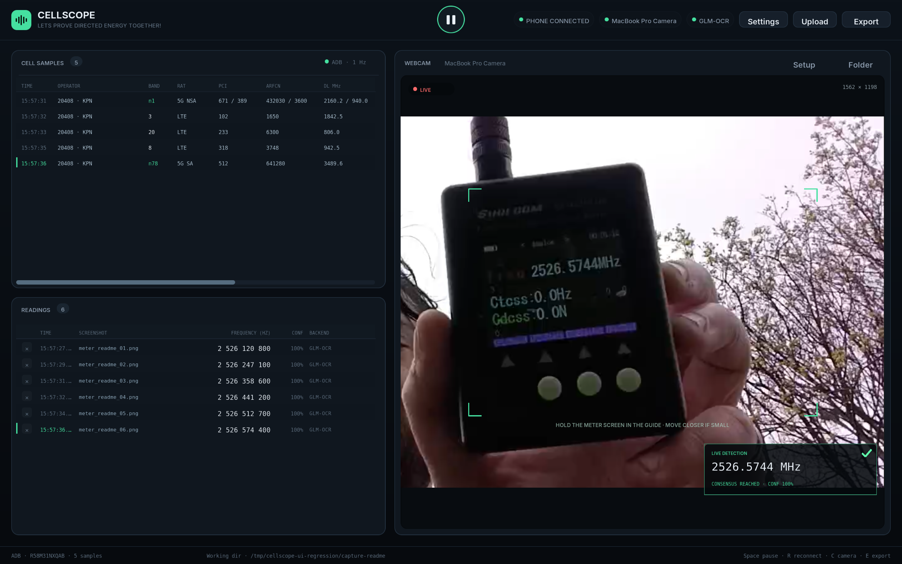

# Radio Defense

**Advancing RF Safety. Empowering Independent Research.**
---

## 📡 About Radio Defense

Radio Defense is an independent research and development organization based in the Netherlands dedicated to radio frequency (RF) security, spectrum enforcement, and the empirical analysis of electromagnetic emissions. 

In an era of increasingly complex cellular networks (4G/5G/6G) and integrated sensing and communication (ISAC), the boundary between network infrastructure and human exposure is blurring. We build open, verifiable, and high-performance tools to investigate anomalous signal patterns, detect unauthorized spectrum usage, and protect against human-targeted sensing or exposure via cellular networks.

Our work is grounded in rigorous, replicable science. We provide the tooling necessary for independent researchers, spectrum regulators, and privacy advocates to audit the electromagnetic environment without relying on opaque, vendor-controlled diagnostics.

---

## 🎯 Core Focus Areas

- **Cellular RF Security & Anomaly Detection**: Monitoring LTE/5G spectrum (particularly uplink bands) to identify protocol violations, unauthorized transmissions, and anomalous signal patterns.
- **Empirical EMF & Directed Energy Research**: Providing open, verifiable tooling to investigate and measure potential directed-energy exposures from cellular infrastructure, independent of operator claims.
- **Advanced Signal Processing**: Utilizing sophisticated DSP techniques (variance analysis, duty cycle tracking, FFT) to distinguish between legitimate network traffic and malicious, rogue, or anomalous emissions.
- **Privacy-Preserving Architecture**: Emphasizing local-first processing, zero telemetry, and cryptographic data integrity to ensure crowd-sourced research remains tamper-evident and privacy-respecting.

---

---

## 🏗️ Architectural Principles

All Radio Defense tooling is built upon a strict set of engineering principles:

1. **Low-Level Performance**: Core utilities are written in **C** to ensure real-time, low-latency hardware interaction and efficient signal processing without the overhead of higher-level runtimes.
2. **Local-First & Zero Telemetry**: Data is processed locally on the researcher's machine. No personal information is shared with third parties unless explicitly stated with an explanation why. Only files that are part of datasets, such as images, RF captures, and cellular metadata are euploaded to cloud servers for later analysis.
3. **Cryptographic Verifiability**: Research datasets are exported as signed archives with per-file `SHA-512` sidecars. This does not prove physical correctness, but it makes silent alteration or tampering of contributed datasets mathematically detectable.
4. **Open Replication**: We design our tools to decentralize data collection. A single measurement is an anecdote; thousands of independently verified, cryptographically signed measurements constitute scientific evidence.

---

---

## 🤝 Getting Involved

Radio Defense relies on a decentralized network of RF security researchers, spectrum enthusiasts, and privacy advocates. 

- **Replicate**: Use our software to contribute to the global dataset on anomalous RF emissions.
- **Audit**: Deploy our software to assess spectrum integrity in your local environment.
- **Contribute**: Submit pull requests, report hardware compatibility issues, or propose new detection heuristics.

> **⚠️ Legal & Ethical Disclaimer**  
> The tools provided by Radio Defense are intended strictly for legal security research, academic study, and authorized spectrum enforcement. Users are responsible for complying with all local, national, and international telecommunications regulations (e.g., ITU-R, national radio authorities) when monitoring or interacting with the RF spectrum.

---

*“The truth is hard to find, and the truth is that governments are either actively abusing telecommunications infrastructure to harm individuals or too afraid to lose face if they admit how penetrated their mobile networks are. When it comes to what is possible with electromagnetic technologies, only an infinitesimal minority understands the true status quo. In the electromagnetic spectrum, verification requires the right methods and tools.”*  
**— Radio Defense**
